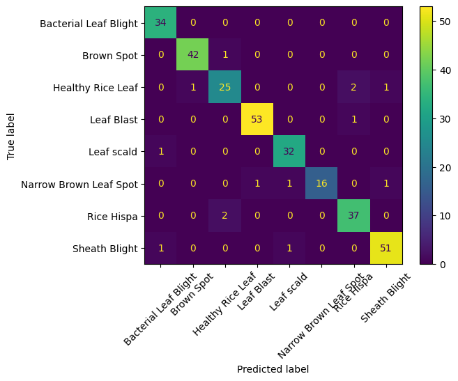
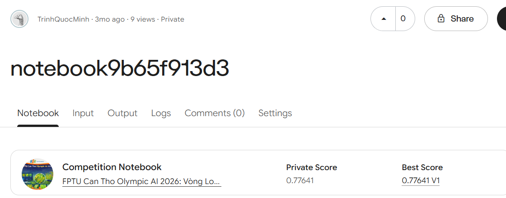

# Rice Leaf Disease Classification | FPTU Can Tho Olympic AI 2026

Image classification of **eight rice-leaf classes**, created for the private FPTU Can Tho Olympic AI 2026 Warmup Kaggle competition.

## Overview and my work

- Processed **2,026 labeled training images** using CLAHE to improve local contrast.
- Extracted **200-dimensional features** based on HSV histograms, color statistics, and HOG.
- Split labeled images into train and validation (**304 validation images, stratified**) **before augmentation**.
- Applied lightweight augmentation to training images, standardized features with `StandardScaler` fit on training data only, and compared **6 classifiers** (Decision Tree, KNN, SVM, Random Forest, Gradient Boosting, AdaBoost) using validation Macro F1.
- Selected **Random Forest**, then retrained on all labeled images to generate the submission file for **300 unlabeled competition test images**.

## Results and evidence

| Evaluation | Metric | Result | Evidence |
|---|---|---:|---|
| Internal validation (304 images) | Accuracy | **95.39% (290/304)** | Notebook classification report / [confusion matrix](results/confusion_matrix.png) |
| Internal validation (304 images) | Macro F1 | **0.9469** | Notebook model comparison |
| Kaggle hidden test (Private 70%) | Macro F1-Score | **0.77641** | [Kaggle score screenshot](results/kaggle_private_score.png) |

### Validation confusion matrix

### Kaggle Private Score

### Evaluation notes

The competition's published evaluation rules specify **Macro F1-Score** as the official scoring metric. The public leaderboard evaluates 30% of the competition test set; the private leaderboard evaluates the other 70%.

- Validation Macro F1: **94.69%**.
- Kaggle Private Macro F1: **77.641%**.
- Difference: approximately **17.05 percentage points**.

The difference between validation and private-test results suggests a possible generalization issue that merits further investigation. The specific causes have **not** been established. These metrics were computed on different datasets and should not be presented as interchangeable.

**Verification limitation:** The competition and original Kaggle notebook are private. The screenshot shows the score displayed to the notebook owner, but the private leaderboard cannot currently be independently accessed by public viewers. The screenshot alone does not document the scoring definition; that definition comes from the competition's Evaluation instructions.

## Data access and reproducibility

The **2 GB competition dataset is not included**. It comes from a private Kaggle competition and may require organizer permission to access or redistribute. Reproduction of the exact reported metrics requires authorized access to the original dataset. This repository provides code and saved outputs for technical review, **not** a claim of full public reproducibility.

The notebook expects Kaggle data beneath `/kaggle/input/`, including a `label_mapping.json`, a `train/` directory, and the test directory defined by its `TEST_FOLDER`. To run it elsewhere, supply an authorized copy of the dataset and adjust `find_dataset_root()` and the input paths.

## Repository files

- `Rice_Leaf_Classification.ipynb` — notebook with saved outputs
- `results/confusion_matrix.png` — internal validation confusion matrix
- `results/submission.csv` — predictions for 300 images (no ground-truth labels)
- `results/kaggle_private_score.png` — Kaggle score screenshot
- `requirements.txt` — approximate dependencies; versions are not pinned

## Reproduction steps (authorized dataset required)

1. Install dependencies with `pip install -r requirements.txt`.
2. Supply an authorized dataset copy with the directory structure expected by the notebook.
3. Open and run `Rice_Leaf_Classification.ipynb`. The notebook uses Kaggle-style `/kaggle/input/` and `/kaggle/working/` paths.
4. Compare the resulting validation Macro F1 and confusion matrix against the saved outputs.

## Sharing note

Before publicly distributing solution code, predictions or screenshots, confirm that the competition rules permit sharing. No raw competition images are included in this repository.
